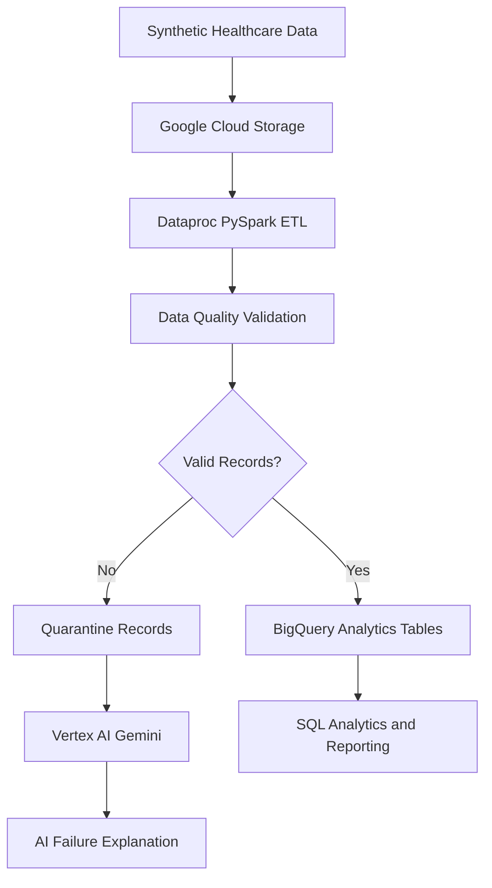

# GenAI-Powered Healthcare Data Engineering & Quality Automation

A Google Cloud-based data engineering project designed to process synthetic healthcare records, automate data-quality checks, and use Generative AI to investigate pipeline failures.

## Project Overview

This project demonstrates a healthcare data pipeline using Google Cloud Platform (GCP), PySpark, BigQuery, and Vertex AI Gemini.

The solution is designed to ingest patient and encounter records, transform raw data, detect quality issues, and generate AI-assisted explanations.

## Technology Stack

| Category | Technologies |
|---|---|
| Programming | Python, PySpark, SQL |
| Cloud Platform | Google Cloud Platform |
| Data Storage | Google Cloud Storage |
| Data Processing | Google Cloud Dataproc |
| Data Warehouse | BigQuery |
| Generative AI | Vertex AI Gemini |
| Data Quality | Python, PySpark, SQL |
| Version Control | Git, GitHub |

## Proposed Architecture



## Key Features

### Healthcare Data Ingestion
- Process synthetic patient and encounter datasets.
- Support CSV-based ingestion.
- Prepare structured data for cloud processing.

### ETL and Data Transformation
- Clean and standardize healthcare records.
- Apply PySpark transformations.
- Prepare BigQuery-compatible datasets.

### Automated Data Quality
- Detect missing patient identifiers.
- Identify duplicate records.
- Validate dates and required fields.
- Separate invalid records for review.

### Generative AI Integration
- Use Vertex AI Gemini to explain validation failures.
- Generate suggested corrective actions.
- Produce readable data-quality summaries.

## Project Structure

```text
gcp-genai-healthcare-data-pipeline/
├── src/
│   ├── ingestion.py
│   ├── transformations.py
│   ├── data_quality.py
│   └── gemini_analysis.py
├── data/
├── sql/
│   └── healthcare_analytics.sql
├── docs/
│   └── architecture.md
├── tests/
├── requirements.txt
└── README.md
```

## Data Source

This project uses synthetic healthcare data.

Reference:
https://github.com/synthetichealth/synthea

No real patient data or protected health information is required.

## Implementation Status

- [x] Repository initialization
- [x] Project structure
- [ ] Synthetic healthcare sample data
- [ ] PySpark ingestion and transformations
- [ ] Automated data-quality checks
- [ ] BigQuery-compatible analytical output
- [ ] Vertex AI Gemini integration
- [ ] Tests and sample results

## Future Enhancements

- Incremental data ingestion
- Automated pipeline scheduling
- Data-quality monitoring dashboard
- AI-generated remediation suggestions

## Disclaimer

This is a personal portfolio project. The architecture represents the intended GCP solution. Cloud deployment and AI integration are not claimed as completed until implemented and tested.
